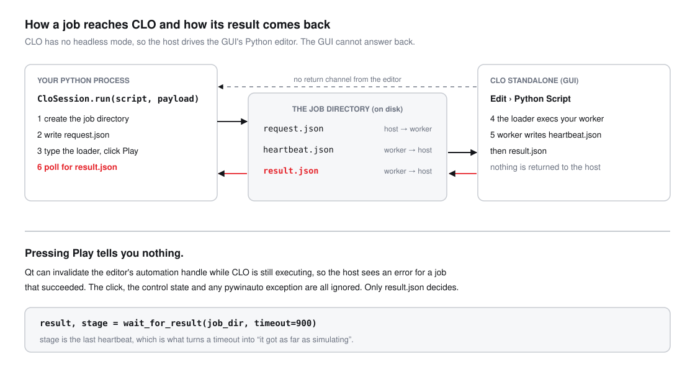
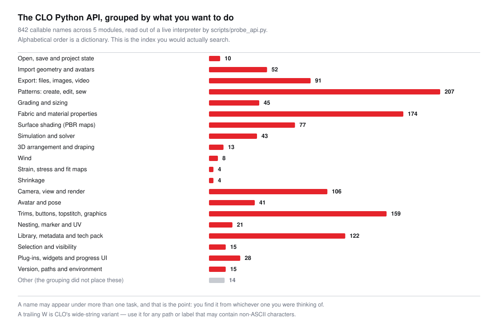

# clo3d-python-bridge

[](https://github.com/ZHOUCHENHAO1221/clo3d-python-bridge/actions/workflows/tests.yml)

Run CLO Standalone's Python API from an ordinary Python process — import patterns, apply
fabrics, simulate, render, export — on a machine where CLO is running.

```python
from clo_bridge import CloSession

with CloSession() as clo:
    info = clo.run("examples/01_hello_clo.py")

print(info["version"], info["patternCount"])
```

---

## Why this exists

CLO exposes about **800 Python functions** across five modules, and gives you **no way to call
them except by hand**: open `Edit > Python Script`, paste, press Play. There is no headless
flag, no `clo --script`, no socket and no RPC. If you have searched for how to automate CLO,
you have already found that there is no answer.

So this package automates that window. Doing so is a few hundred lines. The part that took the
time is everything in [`reference/PITFALLS.md`](reference/PITFALLS.md) — the ways CLO's UI
reports the wrong thing, and what to do about each one. One of them decides the whole design:

> **Pressing Play tells you nothing.** Qt can invalidate the editor's automation handle while
> CLO is still executing, so your automation reports a failure for a job that actually
> succeeded. The only evidence of an outcome is a file the worker itself wrote.



## Install

```bash
git clone https://github.com/ZHOUCHENHAO1221/clo3d-python-bridge
cd clo3d-python-bridge
pip install -e .
```

Windows, Python 3.8 or newer, and `pywinauto`. CLO must already be running and signed in, with
a document open.

## Check that it reaches your CLO

```bash
python examples/01_hello_clo.py
```

This is read-only. It opens nothing, changes nothing and saves nothing, which is why it is the
right first thing to run.

```
CLO 2026.1.224
project: my_garment
patterns: 7
```

If you get `No CLO window with a Python editor was found`, open `Edit > Python Script` in CLO
and run it again. If you get `CLO's Python editor contains a script this bridge did not write`,
that is deliberate — see [Safety](#safety) below.

## What happens when you call `clo.run()`

1. A fresh job directory is created under your temp directory.
2. Your `payload` is written to `request.json` in it.
3. The editor's current contents are read. If someone else's script is there, the run stops.
4. A short loader is typed into the editor and Play is clicked. The loader is plain Python:

   ```python
   # clo_bridge loader - safe to overwrite
   import sys
   if 'C:/dev/clo3d-python-bridge/src' not in sys.path: sys.path.insert(0, '...')
   exec(compile(open('C:/dev/my_worker.py', encoding='utf-8').read(), '...', 'exec'), {
       '__name__': '__main__', '__file__': '...', 'CLO_JOB_DIR': 'C:/Temp/clo_bridge_jobs/...'})
   ```

   Your worker stays a file on disk. It can be reviewed, diffed and version-controlled, which
   text pasted into a GUI box cannot.
5. Inside CLO, `worker.run(main)` calls your function and writes `result.json` — on every path,
   including exceptions, with the traceback in it.
6. The host polls `result.json` and nothing else. It ignores the click, the control state and
   any exception from the UI layer, for the reason quoted above.

The job directory is deleted after a successful run. Pass `keep_jobs=True` while you are
developing a worker and the files stay put so you can read them.

## The package, file by file

| File | Runs where | What it is for |
|---|---|---|
| `src/clo_bridge/session.py` | your process | `CloSession` — find the editor, send a job, wait for the result, raise an error that tells you what to do |
| `src/clo_bridge/editor.py` | your process | The `pywinauto` layer. Matches control ids by **suffix**, so a CLO update does not break it |
| `src/clo_bridge/errors.py` | your process | One exception type per thing you would do differently about it |
| `src/clo_bridge/worker.py` | **inside CLO** | `run(main)` always writes a result; `beat(stage)` says where a job got to |
| `src/clo_bridge/api.py` | **inside CLO** | `require()` name-checks a module before you touch the document; `changed()` asserts the output actually moved |
| `src/clo_bridge/protocol.py` | both | The loader text, the file names, the polling. No GUI, so this is the part the tests cover |
| `scripts/probe_api.py` | both | Reads the API surface out of your own CLO build |
| `scripts/build_api_map.py` | your process | Turns that into `reference/API_MAP.md` |
| `scripts/build_diagrams.py` | your process | Generates the figures in this README |
| `reference/PITFALLS.md` | — | **Read this first.** Every trap, with the symptom stated first, because the symptom is what you will have |
| `reference/API_MAP.md` | — | 818 functions grouped by task |
| `tests/test_offline.py` | anywhere | The whole contract against a fake editor. No CLO, no Windows, no pytest |

## Writing a worker

A worker is an ordinary script. The three helpers exist because each of them prevents a
specific bad afternoon:

```python
from clo_bridge.api import require, changed
from clo_bridge.worker import run, beat

def main(payload):
    importer = require("import_api", "ImportDXFW")
    pattern  = require("pattern_api", "GetPatternCount")

    before = pattern.GetPatternCount()
    beat("importing")
    importer.ImportDXFW(payload["dxf"])
    changed(before, pattern.GetPatternCount(), "pattern count")

    return {"patterns": pattern.GetPatternCount()}

run(main)
```

**`require(module, *names)`** imports the module and checks every function you are about to
call, before anything in the document has been touched. Without it, a build that spells one
function differently fails halfway through, with the garment already half-modified.

**`beat(stage)`** records what the job is doing now. When a job times out, the host reports the
last stage, which is the difference between "it failed" and "it got as far as simulating, and
simulation is slow for this garment".

**`changed(before, after, label)`** raises if the two are equal. This exists because of the
single most expensive mistake in this whole area: you set a property, re-simulate, see no
difference and conclude the property does nothing. Nine times out of ten the fabric was never
applied to the piece you were looking at, and the simulation genuinely re-ran — on unchanged
inputs. "The job ran" and "the parameter took effect" are different claims. Only the second one
is worth reporting.

Then run it:

```python
with CloSession() as clo:
    clo.run("my_worker.py", {"dxf": r"C:\patterns\front.dxf"})
```

## The examples

**[`01_hello_clo.py`](examples/01_hello_clo.py)** asks CLO for its version, the open project's
name and the pattern count, and prints them. Read-only. Every function it uses takes no
argument and was confirmed present by the probe, so this one is safe to trust exactly as
written.

**[`02_import_dxf_simulate_export.py`](examples/02_import_dxf_simulate_export.py)** imports a
DXF, simulates it, exports an OBJ and returns the path and file size:

```bash
python examples/02_import_dxf_simulate_export.py front.dxf out/
```

Worth copying even if you change every call: it compares the pattern count before and after the
import, so an import that quietly brought in nothing is reported as an error rather than
flowing on into a simulation of an empty scene.

**[`03_fixed_camera_fabric_sweep.py`](examples/03_fixed_camera_fabric_sweep.py)** renders the
same garment under several fabrics and returns one image per fabric:

```bash
python examples/03_fixed_camera_fabric_sweep.py fabrics.json out/
```

The camera is captured once at the start and restored before every shot, including the first.
A fabric comparison is only readable if the camera does not move — otherwise every difference
you see is part lens and part cloth and you cannot separate them afterwards. At the end it
hashes the images and fails if the whole sweep produced one identical picture, which means the
fabric never reached the garment.

It also shows something the API map will not tell you on its own: **CLO has no individual
setters for weight, thickness, bending or stretch.** Physical properties go in as a whole
fabric definition through `ChangeFabricWithJsonW`. Looking for a `SetBendingStiffness` will
cost you an afternoon; there isn't one.

> ⚠️ Examples 02 and 03 are **not verified against a running CLO**. Their function *names* come
> from a live probe and `require()` will tell you at once if your build differs. Their
> *argument order* does not — `dir()` cannot report signatures. Check each call against CLO's
> own documentation before you trust the numbers that come out. Example 01 has no arguments to
> get wrong.

## Finding the function you need



[`reference/API_MAP.md`](reference/API_MAP.md) lists all 818 names under the task you would
have been thinking of — importing, fabric, simulation, camera, export, grading and so on — and
a name that fits two tasks is listed under both. Names ending in `W` are the wide-string
variants; use those for any path or label that may contain non-ASCII characters.

The committed map is a contributed snapshot whose CLO build was not recorded. Regenerate it
against your own:

```bash
python scripts/probe_api.py        # read-only; writes scripts/api_surface.json
python scripts/build_api_map.py    # -> reference/API_MAP.md
```

## Safety

The bridge refuses to overwrite a script in the editor that it did not put there. Overwriting
would destroy unsaved work, and the marker comment on the loader's first line is what makes
that check possible. For the same reason the bridge **never saves your project**: saving is a
destructive act on a document you did not author.

It also handles no credentials, automates no sign-in and bypasses nothing. It drives the editor
of an instance a person has already signed in to.

## Honest limits

- **There is no headless mode.** Running this on a server means a real desktop session with CLO
  signed in. Whether your licence allows that is between you and CLO.
- **One job at a time.** CLO's editor is a single slot and the GUI blocks while a script runs.
  Serialise your own queue; do not try to open a second editor.
- **Windows only**, because the UI automation is `pywinauto`.
- **The API map has names, not signatures.** See the warning on the examples above.
- **The UI automation cannot be covered by CI**, because CI has no CLO. The contract —
  loader, worker, results, heartbeats, timeouts, refusals — is fully covered and runs anywhere.

## Tests

```bash
python tests/test_offline.py
```

```
  ok  test_atomic_write_leaves_no_partial_file
  ok  test_heartbeat_survives_into_the_timeout
  ok  test_loader_embeds_windows_paths_without_escape_damage
  ok  test_no_clo_gives_an_actionable_message
  ok  test_overwrites_its_own_leftover_loader
  ok  test_refuses_to_overwrite_someone_elses_script
  ok  test_round_trip
  ok  test_silent_worker_times_out_and_says_where_it_stopped
  ok  test_two_jobs_in_one_session_do_not_share_a_job_dir
  ok  test_worker_exception_reaches_the_host

10 passed
```

The fake editor **executes** the loader it is given, because the loader is ordinary Python. So
these tests exercise the real loader text, the real worker module and the real result protocol
— everything except the four `pywinauto` calls in `editor.py`. CI runs them on Ubuntu and
Windows, on Python 3.8 and 3.12, on purpose: if they ever need a CLO or a Windows API, they
have stopped testing the contract and started testing the UI.

`test_two_jobs_in_one_session_do_not_share_a_job_dir` is there because this suite caught a real
bug. CLO keeps your modules loaded between runs, so a job directory cached at module level made
the second job of a session write its result into the first job's directory — which the host
had already deleted. The host then waited out its whole timeout for a result that had been
written somewhere else.

## Licence

MIT. CLO Standalone is a commercial product of CLO Virtual Fashion Inc. This project is not
affiliated with or endorsed by them and contains no CLO code.
